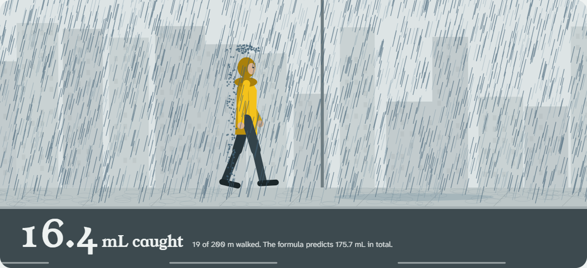
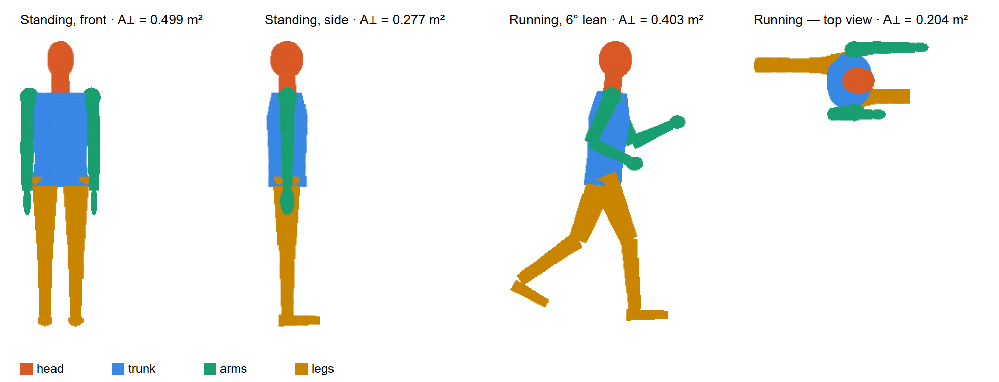

<p align="center">
  <a href="https://www.albertovaldesrey.com/rain-simulation/">
    <picture>
      <source media="(prefers-color-scheme: dark)" srcset="brand/soak-wordmark-white.svg">
      
    </picture>
  </a>
</p>

<h3 align="center">Walk or run in the rain?</h3>

<p align="center">
  An interactive, drop-by-drop simulation of how wet you get, and the physics that decides it.
  <br><br>
  <a href="https://www.albertovaldesrey.com/rain-simulation/"><b>Open the app</b></a>
  &nbsp;·&nbsp;
  <a href="docs/Rain_model.pdf"><b>Read the paper (PDF)</b></a>
  &nbsp;·&nbsp;
  <a href="experiment/PROTOCOL.md"><b>Run the experiment</b></a>
</p>

<p align="center">
  <a href="https://www.albertovaldesrey.com/rain-simulation/"></a>
</p>

## The short answer

**Run, unless the wind is behind you.** In still air or a headwind, the faster you go, the less rain
you catch. With a tailwind of more than about 1 m/s, the driest pace is to **match the wind**: rain
then falls straight down onto you, and your chest and back stay dry.

Over 200 m in moderate rain you catch a few tens of millilitres, roughly a few spoonfuls:

| Wind | Walk (1.4 m/s) | Run (3.3 m/s) | Best pace |
|---|---:|---:|---|
| Still air | 56 mL | 43 mL | as fast as you can |
| 3 m/s headwind | 127 mL | 73 mL | as fast as you can |
| 2 m/s tailwind | 37 mL | 23 mL | 2 m/s, which matches the wind: **16 mL** |
| 5 m/s tailwind | 108 mL | 27 mL | 5 m/s, which matches the wind: **6 mL** |

*Box-shaped body, 5 mm/h rain. A realistic body collects 20–50% less; see below.*

## How it works

All of it follows from one principle. Rain moves at `u = V_rain − V_you` relative to you, and each
part of your body collects water in proportion to how fast that rain moves into it. Over a trip of
length ΔL at speed v:

```
K = C · ΔL / v · |u| · A⊥(û)
```

`C` is the water content of the air and `A⊥(û)` is your silhouette seen from the direction the rain
comes from. For a box-shaped body this gives a closed form:

```
K(v) = C·ΔL · [ (A_top·vt + A_side·|Uy|) / v  +  A_front·|1 − Ux/v| ]
```

The `|1 − Ux/v|` term vanishes at `v = Ux`, which is why matching a tailwind keeps you dry.

## Beyond the box

| | What it adds | Finding |
|---|---|---|
| **Monte Carlo** | Thousands of individual drops tracked in 3D, with hits counted per body face | Agrees with the formula within counting noise in every case |
| **Realistic body** | A human mesh in standing and running poses, with lean | Collects 20–50% less than the box: its frontal area is 0.50 m², not 0.79 m² |
| **Airflow** | Potential flow around the body, with drops traced through it | Deflects 10–30% of wind-driven rain in moderate rain, and 50–90% in drizzle |
| **Field test** | Three absorbent pads on head, chest and back | About 27 trials detect the dip at the wind speed, even in gusty conditions |

<p align="center"></p>

One surprise from the realistic body: in a **strong** tailwind, a runner's forward thigh and
forearms shade the chest from near-vertical rain. Overtaking the wind then costs little, and the
sharp optimum flattens.

## Run it locally

No build step and no dependencies. You need Node.js 20+ for the tests and scripts. To view the app, serve the
repository with any static server (Python's is used here), or open `src/simulation.html` directly.

```bash
git clone https://github.com/Ledsav/rain-simulation.git
cd rain-simulation
python -m http.server          # from the repository root
# then open http://localhost:8000/
```

In VS Code, **Terminal → Run Task… → Setup (fresh clone)** just runs the test suite (there is nothing to install),
and **Dev** starts the static server.

```bash
node --test tests/             # 25 tests: physics, Monte Carlo agreement, airflow, body mesh, experiment analysis
node scripts/analysis.js       # reproduces every number in the paper's later sections
node experiment/simulate-campaign.js   # power analysis for the field experiment
```

**The paper.** `docs/Rain_model.pdf` is committed. To rebuild it, run the **Paper: build PDF** task, or
`pdflatex Rain_model.tex` twice from `docs/` (for the references). It needs a TeX distribution (MiKTeX or TeX Live)
with `pgfplots`, `siunitx` and `booktabs`. The body figure is a manual step:
`node scripts/render-body.js > docs/figures/body_poses.svg`, then export that SVG to `docs/figures/body_poses.png`
(the file the paper and this README use) with any SVG editor or converter. In Windows PowerShell 5.1, `>` writes
UTF-16, so run this redirect, and `node scripts/build-aero-table.js > src/aero-table.js`, from Git Bash or `cmd`.

**Deploying.** GitHub Pages serves the `main` branch from the repository root (**Settings → Pages → Deploy from a
branch → main / (root)**); `.nojekyll` makes it serve the files as they are. Pushing to `main` updates
https://www.albertovaldesrey.com/rain-simulation/.

<details>
<summary><b>Project layout</b></summary>

| Path | What it is |
|---|---|
| `index.html` | Entry point; redirects to the app |
| `src/simulation.html` | The interactive app |
| `src/rain-model.js` | Closed-form model and 3D Monte Carlo engine |
| `src/aero.js` | Airflow around the body and drop trajectories (collection efficiency η) |
| `src/aero-table.js` | Precomputed η grid, rebuilt with `node scripts/build-aero-table.js > src/aero-table.js` |
| `src/body.js` | Parametric human mesh, OBJ loader for 3D scans, silhouette rasteriser |
| `src/refined.js` | Combined estimate: human body plus airflow |
| `docs/Rain_model.tex`, `.pdf` | The paper |
| `experiment/` | Field protocol, data template, analysis and power simulation |
| `scripts/` | Analysis and figure scripts |
| `brand/` | Wordmark, icon and logo concepts |
| `tests/` | Node test suite |

</details>

## Run the experiment

The model makes a sharp, testable prediction. [`experiment/PROTOCOL.md`](experiment/PROTOCOL.md)
explains how to test it on a rainy, windy afternoon with a kitchen scale and three pads.
`experiment/analyze.js` fits your data. If you run it, please open an issue with your results.
